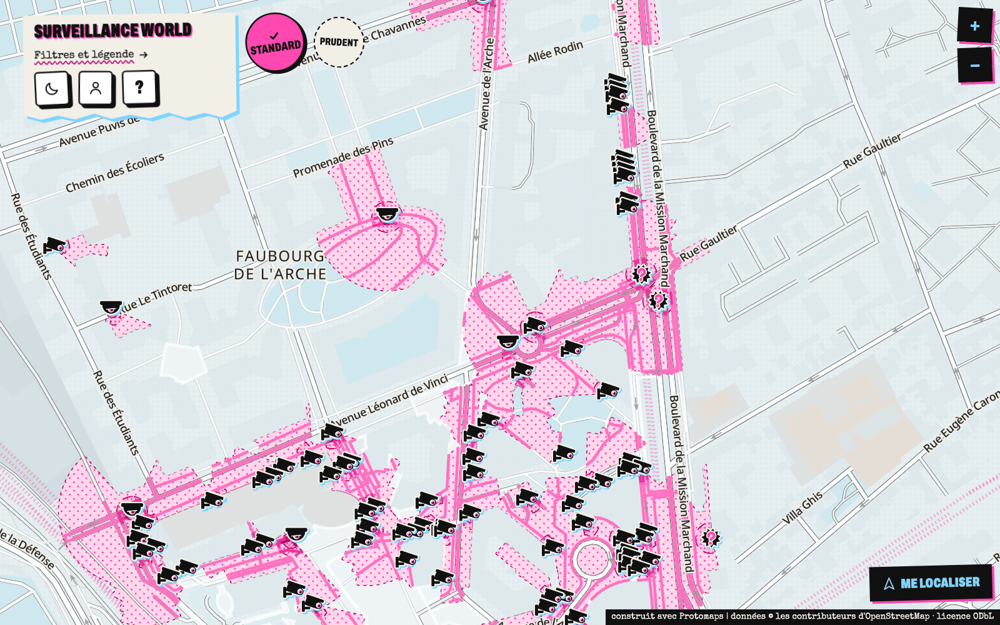
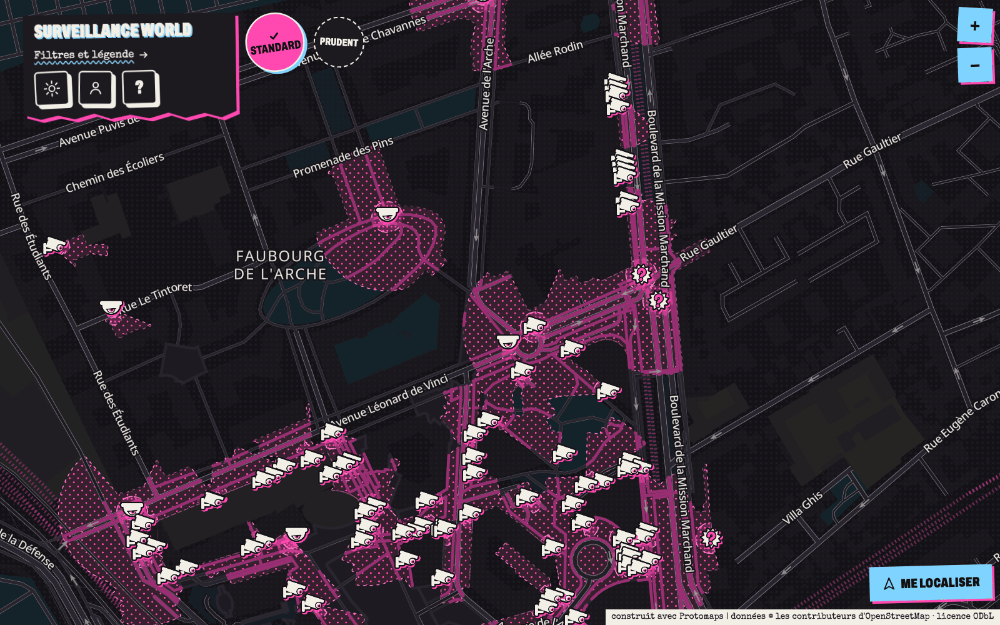
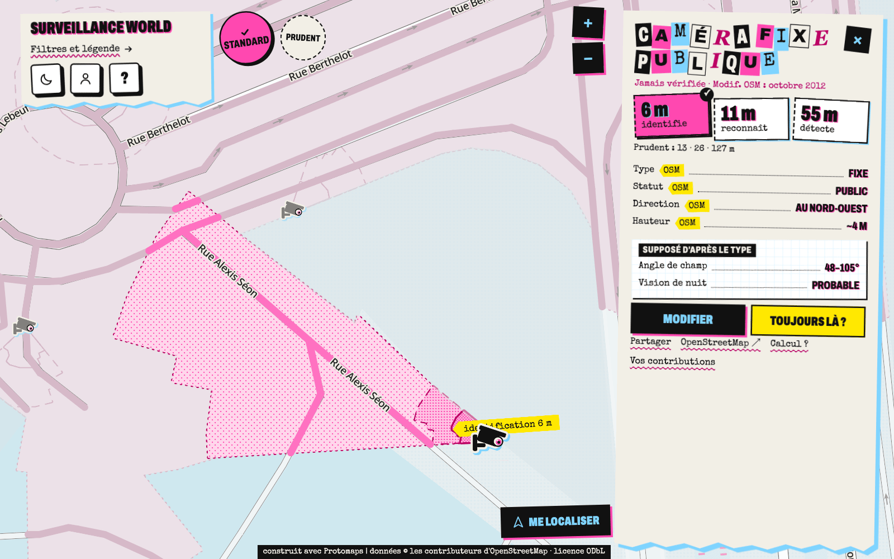
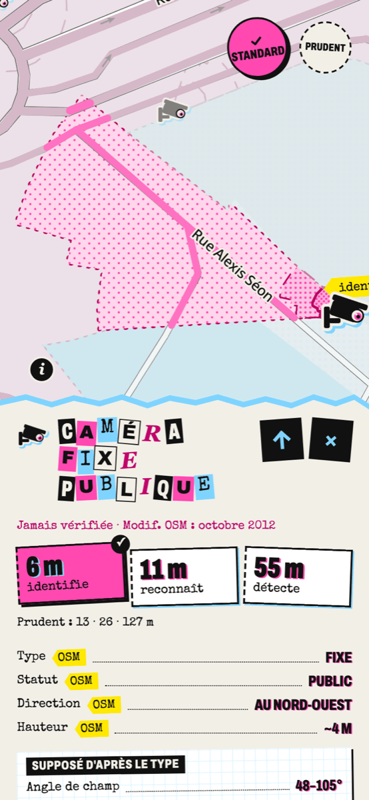
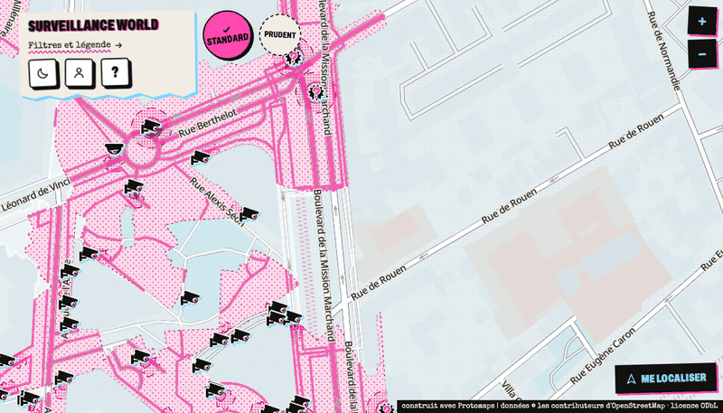
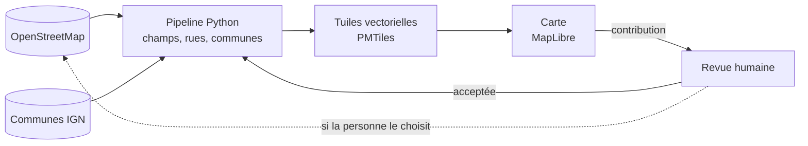

# Surveillance World

> **In English.** A map of the video surveillance cameras mapped in OpenStreetMap, and of
> what each one can film, street by street: its field of view cut by the buildings, and
> where it can identify, recognise or detect a person (IEC 62676-4). Everything is computed
> ahead of time from open data; the site shows vector tiles, with no tracker and no
> third-party service. Code AGPL-3.0-or-later, data ODbL. The site and the docs are in French.


**La carte des caméras de surveillance, et de ce qu'elles peuvent filmer, rue par rue.**

## Ce que c'est

Les contributeurs d'OpenStreetMap ont recensé des dizaines de milliers de caméras en France.
Surveillance World les place sur une carte et calcule, pour chacune, la zone qu'elle peut
filmer et les rues qu'elle couvre, en tenant compte des bâtiments qui lui bouchent la vue.
La carte couvre la France métropolitaine, Corse comprise ; l'outre-mer viendra plus tard.

| La carte | En mode sombre |
|---|---|
|  |  |

| La fiche d'une caméra | Au téléphone |
|---|---|
|  |  |



*Captures prises sur l'extrait de test (La Défense).*

## Comment ça marche



- **Une estimation optique.** Pour chaque type de caméra, une distribution de résolutions et
  d'angles de champ tirée des fiches des fabricants (`catalogue/`, `rules/optics.yaml`) donne
  la distance à laquelle elle peut **identifier**, **reconnaître** ou **détecter** une
  personne (niveaux de la norme IEC 62676-4).
- **Deux hypothèses.** « Standard » montre ce qu'une caméra filme avec une probabilité d'au
  moins 50 % ; « Prudent », au moins 10 % : la zone qu'une caméra plutôt haut de gamme
  pourrait couvrir.
- **Un champ exact.** Chaque champ est découpé par les bâtiments d'OSM, puis reporté sur les
  rues. Chaque valeur garde son degré de certitude (connue, estimée ou supposée), jusque
  dans la fiche.

## Le registre

Le second volet du site, sous `/registre/` : les documents publics de la vidéosurveillance,
liés aux communes, aux entreprises et aux acheteurs. Les contrats publics (données
essentielles de la commande publique, data.gouv.fr) et les avis de marché (BOAMP, DILA), les
arrêtés des préfectures (recueils des actes administratifs, le Rhône d'abord) et les
subventions (listes des régions et des préfectures). Les entreprises sont vérifiées dans le
répertoire SIRENE (INSEE) ; un particulier ou un commerçant en nom propre n'est jamais nommé.

Le registre s'ouvre sur la carte, qui reste derrière : une fenêtre au grand écran, une feuille
au téléphone. Chaque fiche dit son type (territoire, acheteur, entreprise, document) par un
pictogramme, un mot et une couleur, suit la même ossature (l'essentiel, dans le temps, avec qui,
documents, sources) et se partage par un lien. Toute mention d'une fiche est un lien vers elle.

- **Lu par un programme.** Personne ne relit les arrêtés ; le site le dit, publie la liste de
  ceux qui n'ont pas pu être lus entièrement, et chaque document mène à sa source. « Signaler
  une erreur » corrige le registre : un formulaire sans compte, relu dans `/revue`, et une
  correction acceptée est appliquée à la construction suivante ; la page du document dit
  « corrigé le … » et garde, barrée, la valeur publiée par la source. Rien n'est gardé sur
  l'expéditeur, sauf le contact s'il en donne un (effacé à la décision, au plus tard après
  90 jours).
- **Daté.** La page « Ce que couvre le registre » dit, source par source, jusqu'à quelle date
  vont les documents et quand ils ont été collectés.
- **Une règle de calcul.** Un total additionne le montant prévu de chaque contrat signé, sans
  les contrats d'acheteurs nationaux, les plafonds de centrales d'achat, les contrats mixtes,
  les montants à vérifier ni les doublons (`pipeline/lacarte_registre/`).
- **Aucun PDF hébergé** : l'identifiant de l'acte, l'adresse du recueil, sa page et son
  empreinte seulement. Aucun croisement avec la délinquance.

Les données sont construites hors ligne et servies en fichiers statiques :

```bash
uv run lacarte-registre importer-pilote <dossier de l'export pilote>
LACARTE_ROBOT_CONTACT=<contact> uv run lacarte-registre collecter   # la France entière
uv run lacarte-registre construire   # data/registre/site, servi sous /data/registre/
```

`collecter` lit les sources nationales (DECP, BOAMP, SIRENE, communes) par un seul module
(`fetch.py`) qui respecte les `robots.txt` (RFC 9309), dit qui il est
(`SurveillanceWorld/<version> (+<contact>)`, le contact venant de `LACARTE_ROBOT_CONTACT`), va
à une requête par seconde et s'arrête sur un refus ; `--resume` reprend une collecte coupée.
Les sorties ne sont mises en place que si toutes les sources ont répondu. `construire` reste
hors ligne : il fusionne la commande publique nationale et ce qui vient du pilote (arrêtés,
zones de drones, subventions), écrit les fichiers servis, la page d'entrée et l'image d'aperçu
de chaque fiche, et les lignes de la recherche, chargées dans la base au déploiement
(`db/load_registre.sh`). `lacarte-registre comparer AVANT APRÈS` sort le tableau des chiffres
du pilote avant et après une construction.

`construire` exporte d'abord, depuis la base (par SSH vers `DEPLOY_TARGET`, ou `--ssh`, ou
`--dsn`), les corrections acceptées dans `/revue` vers `data/registre/corrections.yaml` (jamais
versionné, comme `lacarte contrib export`), puis les applique après
`rules/registre_corrections.yaml` ; il s'arrête sur une correction qu'il ne sait pas appliquer.
Sans la base, il refuse, sauf `--sans-corrections` (un essai) : un registre ainsi construit n'est
jamais déployé (`lacarte-registre verifier`, que lance `deploy/deploy.sh`). Les données essentielles de la commande publique, le BOAMP et SIRENE sont
sous Licence Ouverte 2.0 ; chaque document est cité avec sa source.

## Vie privée par construction

- Aucun traceur, aucun cookie de mesure : la carte n'appelle aucun service tiers. Le fond de
  carte, les polices et les tuiles sont servis par le site lui-même.
- Aucune adresse IP gardée : le serveur web ne les journalise pas et l'API ne les reçoit
  jamais.
- Des compteurs agrégés seulement (cartes chargées, connexions), par heure puis par jour,
  sans identifiant ni rien d'écrit sur l'appareil.
- « Me localiser » : la position reste sur l'appareil, elle n'est ni envoyée ni gardée.
- Les contributions ne gardent que le jour (jamais l'heure) et, sur la carte, le mois.

## Lancer en local

Il faut [uv](https://docs.astral.sh/uv/), Node 22, `osmium-tool`, `tippecanoe` et
`pmtiles` (macOS : `brew install osmium-tool tippecanoe pmtiles`).

```bash
make install                 # dépendances Python et web
make check                   # lint et tests (Python et web)
mkdir -p data/contrib && cp tests/fixtures/contrib-ci.jsonl data/contrib/ci.jsonl
make build REGION=ci         # le pipeline complet sur l'extrait de test (La Défense, ~10 s)
make web REGION=ci           # la carte sur http://localhost:5173
```

Pour essayer aussi les contributions, les comptes et la revue (il faut en plus PostgreSQL
avec PostGIS : `initdb` et `pg_ctl` dans le PATH, ou `PG_BIN`) :

```bash
make try                     # http://127.0.0.1:4470/ — Ctrl-C arrête tout
```

`make try` lance l'API sur une base jetable, remplie avec les données de test. Un compte
contributeur fictif est connecté d'office ; `?as=rev` passe sur le compte administrateur,
qui ouvre `/revue`.

### Toute la France métropolitaine

La France se construit par morceaux : les 22 anciennes régions (`fr-*` dans `regions.yaml`),
chacune découpée dans l'extrait France avec une marge de 480 m, puis fusionnées
(`pipeline/lacarte/merge.py`). Comptez quelques heures et 24 Go de mémoire ; la commande
reprend là où elle s'est arrêtée avec `--from parts --resume`, et s'arrête d'elle-même sous
50 Go libres (`LACARTE_MIN_FREE_GB`). Le contour de la France (la relation OSM de niveau 2,
mer territoriale comprise) est tiré du même extrait : les caméras de Monaco, de Genève ou de
Sarrebruck prises dans la marge sortent dès l'extraction, celles d'une jetée ou d'une plage
vont à la commune la plus proche à moins de 500 m (`rules/admin.yaml`).

```bash
curl -L -o data/france/src/france-latest.osm.pbf \
  https://download.geofabrik.de/europe/france-latest.osm.pbf
uv run lacarte contrib export --region france     # sur le serveur : la base suivie
make build REGION=france       # tuiles dans data/build/france/tiles
pmtiles extract https://build.protomaps.com/<YYYYMMDD>.pmtiles data/france/basemap/france-full.pmtiles \
  --region=<contour de la métropole, GeoJSON> --maxzoom=15
uv run lacarte basemap strip data/france/basemap/france-full.pmtiles data/basemap/france.pmtiles \
  --drop pois --names fr en --undrawn   # sans ce que le style ne dessine pas (rules/basemap.yaml)
uv run lacarte basemap check data/basemap/france.pmtiles   # fait par ce code ?
make web REGION=france
```

Le fond de carte a son propre identifiant, hors de celui de la construction : `strip`
l'écrit dans l'archive (le code de `pipeline/lacarte/basemap.py`, `rules/basemap.yaml`, les
options et l'en-tête de l'archive source). Un changement du fond ne demande pas de
reconstruire, ni l'inverse ; après un changement de `basemap.py` ou de `rules/basemap.yaml`,
`check` refuse l'ancienne archive et le déploiement s'arrête : refaites le `strip`.

### Toute l'Île-de-France

Comptez environ 16 minutes sur un portable à 8 cœurs.

```bash
curl -L -o data/src/ile-de-france-latest.osm.pbf \
  https://download.geofabrik.de/europe/france/ile-de-france-latest.osm.pbf
B=https://data.geopf.fr/telechargement/download/ADMIN-EXPRESS-COG-CARTO/ADMIN-EXPRESS-COG-CARTO_4-0__GEOPARQUET_WGS84G_FRA_2026-01-01
for f in commune arrondissement_municipal departement; do   # communes IGN, 133 Mo
  curl -L --create-dirs -o data/src/admin-express-2026/$f.parquet $B/$f.parquet; done
make build REGION=idf        # tuiles dans data/build/idf/tiles, contrôles dans qa/out/idf
pmtiles extract https://build.protomaps.com/<YYYYMMDD>.pmtiles data/basemap/idf-full.pmtiles \
  --bbox=1.44,48.12,3.56,49.24 --maxzoom=15   # le fond de carte, auto-hébergé
uv run lacarte basemap strip data/basemap/idf-full.pmtiles data/basemap/idf.pmtiles \
  --drop pois --names fr en --undrawn
uv run lacarte basemap check data/basemap/idf.pmtiles
make web REGION=idf
```

Les régions sont déclarées dans `regions.yaml` ; les valeurs par défaut et les règles de
classement, chacune avec son identifiant et sa justification, dans `rules/`.

## Contribuer

Une caméra manque, est mal placée ou n'existe plus ? Elle se corrige dans OpenStreetMap :
la carte est reconstruite à partir d'OSM. Pour le code et les signalements, voir
[CONTRIBUTING.md](CONTRIBUTING.md). Pour une faille de sécurité, voir [SECURITY.md](SECURITY.md).

## Limites

Les zones et les distances sont des **estimations**, calculées à partir des données d'OSM et
d'hypothèses optiques : ce n'est ni un constat qu'une caméra filme un lieu, ni un avis
juridique sur sa conformité. Une caméra absente d'OSM n'apparaît pas sur la carte.

## Licences et crédits

- Code : [AGPL-3.0-or-later](LICENSE).
- Données dérivées (tuiles, fichiers intermédiaires) : [ODbL 1.0](LICENSE-DATA),
  © les contributeurs d'OpenStreetMap.
- Contributions faites sur le site : CC0, pour que la couche puisse être publiée sous ODbL.
- Communes, arrondissements et départements : IGN – Admin Express COG Carto, édition du
  1er janvier 2026, Licence Ouverte 2.0.
- Catalogue des caméras (`catalogue/`) : [CC0 1.0](https://creativecommons.org/publicdomain/zero/1.0/),
  tiré des fiches techniques des fabricants et des appels d'offres publics des communes,
  chaque ligne avec sa source.
- Fond de carte : [Protomaps](https://protomaps.com) (données OSM, ODbL), glyphes Noto Sans
  (SIL OFL 1.1) et icônes tangrams (MIT) de `basemaps-assets`. Rendu par
  [MapLibre GL JS](https://maplibre.org) (BSD-3-Clause).
- Polices de l'interface : Archivo (SIL OFL 1.1) et Special Elite (Apache 2.0), modifiées
  (voir [`web/src/theme/fonts/README.md`](web/src/theme/fonts/README.md)). Le site sert
  toutes les notices tierces à `/licences.txt`.
- Fixtures de test (`tests/fixtures/`) : extrait OSM et extrait du fond Protomaps sur
  La Défense (ODbL), communes IGN découpées (Licence Ouverte 2.0), contributions inventées ;
  extrait du registre (`tests/fixtures/registre/` : contrats, avis, arrêtés et subventions sous
  Licence Ouverte 2.0, couches de carte de Mions sous ODbL).
- Sources consultées : les données, le wiki et taginfo d'OSM, les fiches des fabricants, les
  normes et la documentation des bibliothèques. Aucun code, texte ni jeu de données d'autres
  projets de cartographie des caméras n'est lu ni repris.

Imaginé par lagayayuya.

## Héberger une instance

`deploy/` contient les scripts d'un déploiement auto-hébergé (Caddy, PostgreSQL et PostGIS,
une API Python), réglés uniquement par des variables d'environnement : voir
[`deploy/deploy.env.example`](deploy/deploy.env.example). Rien du serveur n'est écrit dans
le dépôt.

`deploy/deploy.sh` demande, avant de rien construire ni envoyer, les tuiles de la région
(`data/build/<région>/tiles`) et son fond de carte (`data/basemap/<région>.pmtiles`), fait
par le code en place : `uv run lacarte basemap check`, sinon refaites le `strip` (plus haut).

- **Comptes.** On entre avec son compte OpenStreetMap (OAuth 2.0 avec PKCE, portée
  `openid` ; le jeton est révoqué aussitôt et seul l'identifiant OSM numérique est gardé). Les
  comptes à mot de passe (administration, revue) se gèrent en ligne de commande :
  `uv run lacarte accounts --help`. Un mot de passe ne passe jamais en argument.
- **Applications OSM.** Une application confidentielle par serveur OSM (test et réel), avec
  l'URI de retour `https://<votre hôte>/api/osm/callback`. Leurs identifiants vont dans
  l'environnement du déploiement, jamais dans le dépôt.
- **Publication sur OSM.** Seulement si la personne le choisit, sous son propre compte OSM.
  Seules partent ses observations faites sur place, une fois acceptées une à une par la revue
  et appliquées par une construction : `rules/publish.yaml`.
- **Contributions acceptées.** Elles entrent à la construction suivante :
  `uv run lacarte contrib export` écrit `data/contrib/<région>.jsonl`, que l'étape `apply`
  applique (`rules/contributions.yaml`).
